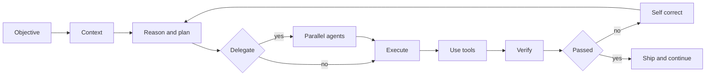
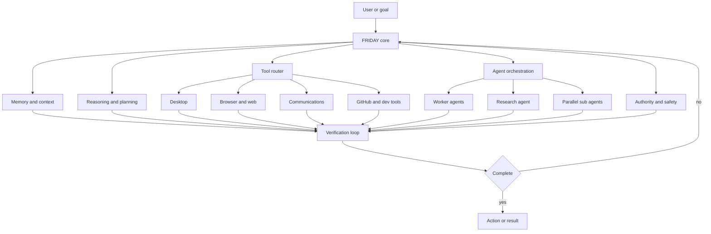
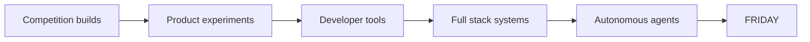
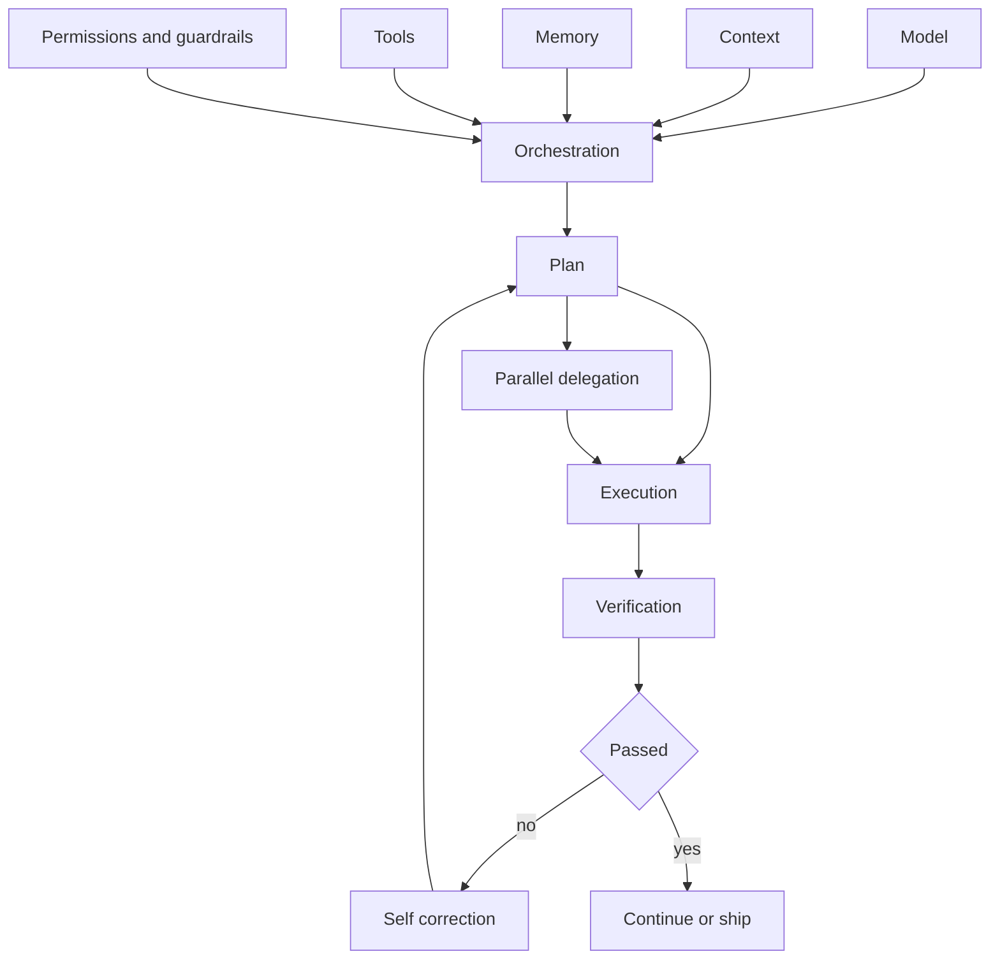
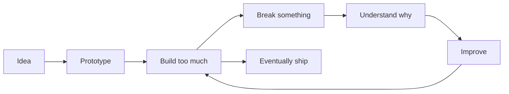

# Hey, I'm Arnav 👋
### `hackers-reality`

 

 

### `context → reason → plan → delegate → execute → verify → self-correct → continue`

---

## 🧠 I build systems that act

I build **autonomous AI agents, developer tools, automation-heavy systems and full-stack products**.

I'm less interested in another chatbot wrapper and more interested in what happens **after the first model response**: context, memory, tools, permissions, orchestration, parallel workers, verification loops and the engineering required to let an agent keep moving without turning autonomy into chaos.

A strong model helps. But the system around it determines how much of that intelligence survives contact with a real task.

---

## 🤖 Flagship — [FRIDAY](https://github.com/hackers-reality/friday)

> **A Windows-native autonomous AI agent built around observation, memory, tools, delegation and action.**

FRIDAY is my largest agentic-system project. Its current repository documents voice/live audio, screen awareness, desktop and browser automation, persistent memory, goals, communications, model routing, multi-agent delegation, parallel sub-agents, research workflows, scheduling, GitHub integration, self-modification, sidecars, dashboards and a large tool surface.

The interesting question isn't *“can an LLM answer me?”* It's:

**Can a personal AI observe its environment, remember what matters, choose tools, coordinate work, verify itself and actually finish things?**

**→ [Explore FRIDAY](https://github.com/hackers-reality/friday)**

---

## 🚀 Selected builds

<table>
<tr>
<td width="50%" valign="top">

### 💹 [FinIntel](https://github.com/hackers-reality/FinIntel)
AI-assisted financial intelligence and analysis experiments.

</td>
<td width="50%" valign="top">

### 🎌 [NexAnime](https://github.com/hackers-reality/NexAnime)
Product and full-stack engineering from the application side of my work.

</td>
</tr>
<tr>
<td width="50%" valign="top">

### 🖥️ [NexCli](https://github.com/hackers-reality/NexCli)
CLI tooling and developer experimentation — because apparently GUIs weren't enough trouble.

</td>
<td width="50%" valign="top">

### 📚 [JEE Prep](https://github.com/hackers-reality/JEE-prep)
Applying software engineering to learning and preparation.

</td>
</tr>
</table>

### 🏁 Where it started

**[EmoBoost](https://github.com/hackers-reality/EmoBoost-1021)** and **[Innovation Challenge](https://github.com/hackers-reality/innovatiochallenge_3011)** are among my earliest repositories and were built for competitions. They stay visible because they show the beginning of the trajectory, not because I'm pretending an early competition build is the same thing as FRIDAY today.

> This profile is curated. Some repositories on the account are forks, references, experiments or old work; the projects above are intentionally selected rather than treating every repository as authored flagship work.

---

## ⚙️ Languages & tools

### Things I keep going too far into

`LLM Agents` · `Context Engineering` · `Prompt Engineering` · `Tool Calling` · `Multi-Agent Systems` · `Automation` · `Research Workflows` · `Full-Stack Architecture` · `APIs` · `Authentication` · `Databases`

---

## 🧩 Agent engineering philosophy

The model is a component, not the whole architecture.

My favorite engineering loop is giving an agent a real objective, enough context to understand the system, permission to inspect its environment, the ability to delegate when useful, and one non-negotiable rule: **verify what you built before claiming you're done.**

The prompt matters. The working context matters. Tool design matters. Delegation matters. Verification matters. A benchmark score by itself doesn't tell you how well the complete system will behave once you hand it a messy repository and tell it to keep going.

---

## 🔬 Portfolio + laboratory

GitHub for me is both. Some repositories are polished projects; others are prototypes, experiments and evidence of an idea arriving at an unreasonable hour.

The mess is useful. You can see the progression instead of only the finished screenshot.

---

## 📊 Activity

---

## 📬 Contact

If you want to talk about a project, collaboration, competition, AI agents, or something worth building:

### ✉️ [phulariarnav@gmail.com](mailto:phulariarnav@gmail.com)
### 📸 [@phulari_arnav](https://www.instagram.com/phulari_arnav/)

I keep personal contact details such as my phone number private. If a conversation needs them, I'll share them directly.

*A personal portfolio site will eventually live here too. Until then, GitHub is the laboratory.*

---

### `BUILD → VERIFY → SHIP → LEARN → BUILD AGAIN`

**[FRIDAY](https://github.com/hackers-reality/friday) · [All repositories](https://github.com/hackers-reality?tab=repositories)**

The interesting engineering begins after the first model response.

