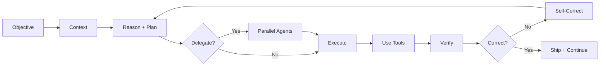
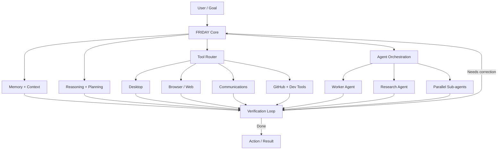
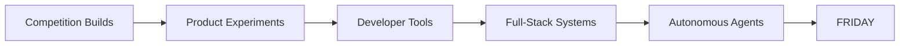
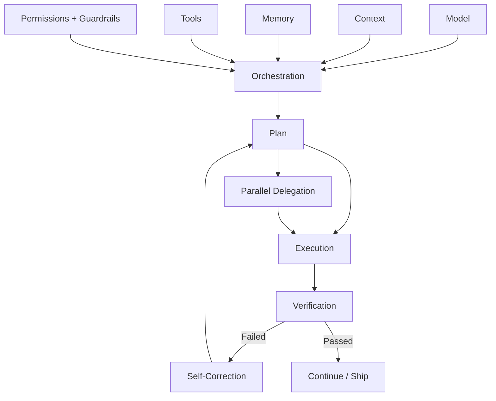
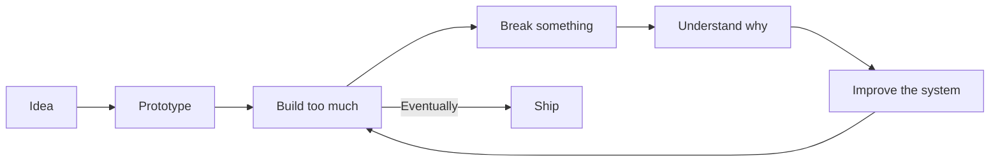

# Hey, I'm Arnav 👋
### `hackers-reality`

 

### `context → reason → plan → delegate → execute → verify → self-correct → continue`

---

## 🧠 I build systems that act

I build **autonomous AI agents, developer tools, automation-heavy systems and full-stack products**.

I'm less interested in another chatbot wrapper and more interested in what happens **after the first model response**: context, memory, tools, permissions, orchestration, parallel workers, verification loops and the engineering required to let an agent keep moving without turning autonomy into chaos.

A strong model helps. But the system around it determines how much of that intelligence survives contact with a real task.

---

## 🤖 Flagship — [FRIDAY](https://github.com/hackers-reality/friday)

> **A Windows-native autonomous AI agent built around observation, memory, tools, delegation and action.**

FRIDAY is my largest agentic-system project: voice and live audio, screen awareness, desktop/browser automation, persistent memory, goals and productivity enforcement, communications, model routing, multi-agent delegation, parallel sub-agents, research workflows, scheduling, GitHub integration, self-modification, sidecar networking, dashboards and more.

The interesting question isn't *“can an LLM answer me?”* It's:

**Can a personal AI observe its environment, remember what matters, choose tools, coordinate work, verify itself and actually finish things?**

**→ [Explore FRIDAY](https://github.com/hackers-reality/friday)**

---

## 🚀 Selected builds

| Project | What it represents |
|---|---|
| 💹 **[FinIntel](https://github.com/hackers-reality/FinIntel)** | AI-assisted financial intelligence and analysis experiments. |
| 🎌 **[NexAnime](https://github.com/hackers-reality/NexAnime)** | Product/full-stack engineering on the application side of my work. |
| 🖥️ **[NexCli](https://github.com/hackers-reality/NexCli)** | CLI tooling and developer experimentation — because apparently GUIs weren't enough trouble. |
| 📚 **[JEE Prep](https://github.com/hackers-reality/JEE-prep)** | Applying software engineering to learning and preparation. |

### 🏁 The early builds

**[EmoBoost](https://github.com/hackers-reality/EmoBoost-1021)** and **[Innovation Challenge](https://github.com/hackers-reality/innovatiochallenge_3011)** are among my first repositories and were built for competitions. They aren't here because they're my most advanced work; they're here because they show where the trajectory started.

> This profile is curated. Some repositories on the account are forks, references, experiments or old work; I don't pretend every repo under an account is something I authored. Revolutionary concept, apparently. 😭

---

## ⚙️ Stack

### Things I keep going too far into

`LLM Agents` · `Context Engineering` · `Prompt Engineering` · `Tool Calling` · `Multi-Agent Systems` · `Automation` · `Research Workflows` · `Full-Stack Architecture` · `APIs` · `Authentication` · `Databases`

---

## 🧩 How I think about agent engineering

The model is a component, not the whole architecture.

My favorite engineering loop is giving an agent a real objective, enough context to understand the system, permission to inspect its environment, the ability to delegate when useful, and one non-negotiable rule: **verify what you built before claiming you're done.**

---

## 🔬 Portfolio + laboratory

GitHub for me is both. Some repositories are polished projects; others are prototypes, experiments and evidence of an idea arriving at an unreasonable hour.

The mess is useful. You can see the progression instead of only the finished screenshot.

---

## 📊 Activity

<b>Why only one external stats graphic?</b>

 

Profile README widgets are convenient until somebody else's endpoint has a bad day and your portfolio suddenly develops broken-image icons. The architecture diagrams above are native GitHub Mermaid instead; the activity graph stays because it communicates something GitHub Markdown cannot generate by itself.

---

### `BUILD → VERIFY → SHIP → LEARN → BUILD AGAIN`

**[FRIDAY](https://github.com/hackers-reality/friday) · [All repositories](https://github.com/hackers-reality?tab=repositories)**

The interesting engineering begins after the first model response.

