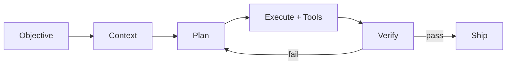
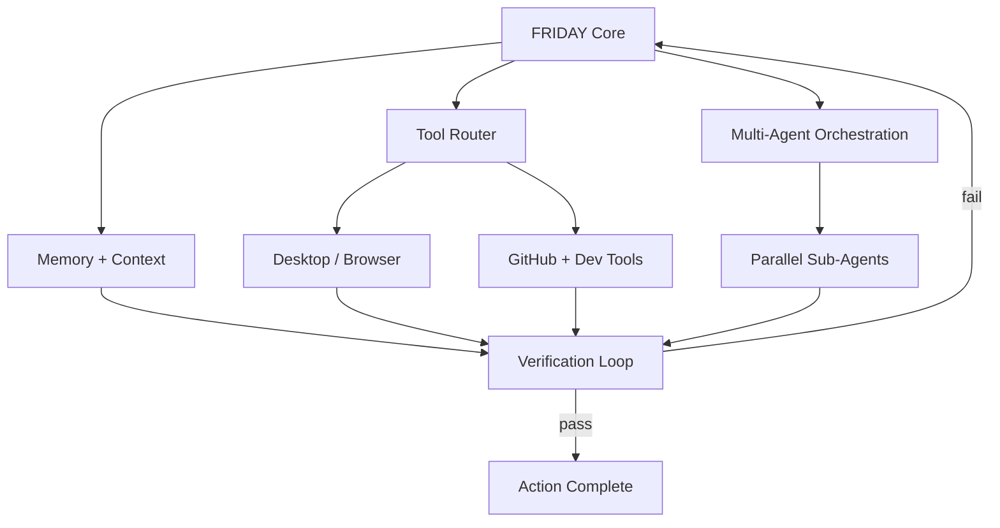

# Hey, I'm Arnav 👋
### `hackers-reality`

 

  

 

## 🧠 I build systems that act

I build **autonomous AI agents, developer tools, and full-stack products** — less interested in another chatbot wrapper, more interested in what happens *after* the first model response: context, memory, tools, delegation, and verification loops that let an agent keep moving without turning autonomy into chaos.

A strong model helps. The system around it decides how much of that intelligence survives contact with a real task.

 

## 🤖 Flagship — [FRIDAY](https://github.com/hackers-reality/friday)

> A Windows-native autonomous AI agent — voice, screen awareness, desktop/browser automation, persistent memory, multi-agent delegation, and self-verification.

The question isn't *"can an LLM answer me?"* — it's **can a personal AI observe its environment, remember what matters, pick the right tool, coordinate sub-agents, and actually finish the job?**

**→ [Explore FRIDAY](https://github.com/hackers-reality/friday)**

 

### 🚀 Selected builds

- **[FRIDAY](https://github.com/hackers-reality/friday)** — Windows-native autonomous AI agent
- **[FinIntel](https://github.com/hackers-reality/FinIntel)** — AI-assisted financial intelligence and analysis
- **[NexAnime](https://github.com/hackers-reality/NexAnime)** — Self-hosted anime streaming/tracking app
- **[JEE Prep](https://github.com/hackers-reality/JEE-prep)** — Software engineering applied to exam prep

### 🏁 Where it started

**[EmoBoost](https://github.com/hackers-reality/EmoBoost-1021)** and **[Innovation Challenge](https://github.com/hackers-reality/innovatiochallenge_3011)** are early competition builds. They stay pinned-visible because they show the trajectory — not because they're the same caliber as FRIDAY today.

`Competition builds` → `Product experiments` → `Developer tools` → `Full-stack systems` → `Autonomous agents`

> This profile is curated. Some repos are forks, references, or experiments — the projects above are intentionally selected, not a full inventory.

 

## ⚙️ Languages & tools

### Things I keep going too far into

`LLM Agents` · `Context Engineering` · `Multi-Agent Systems` · `Automation` · `Full-Stack Architecture` · `APIs` · `Databases`

 

## 📬 Contact

### ✉️ [phulariarnav@gmail.com](mailto:phulariarnav@gmail.com) · 📸 [@phulari_arnav](https://www.instagram.com/phulari_arnav/)

*Phone number stays private — I'll share it directly if a conversation needs it.*

 

### `BUILD → VERIFY → SHIP → LEARN → BUILD AGAIN`

**[FRIDAY](https://github.com/hackers-reality/friday) · [All repositories](https://github.com/hackers-reality?tab=repositories)**

The interesting engineering begins after the first model response.

